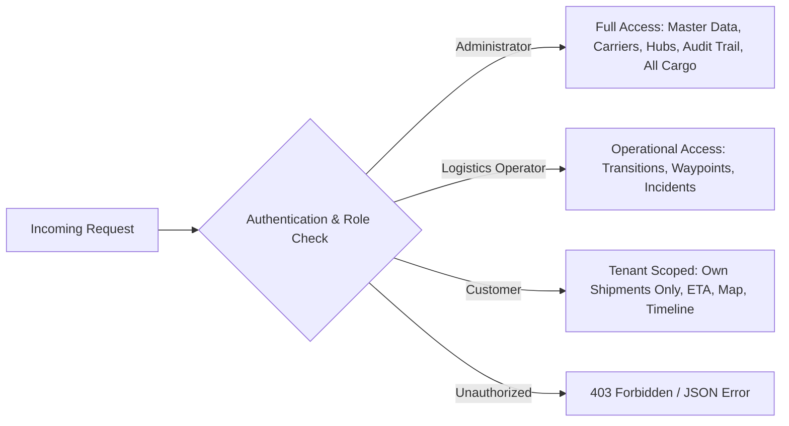
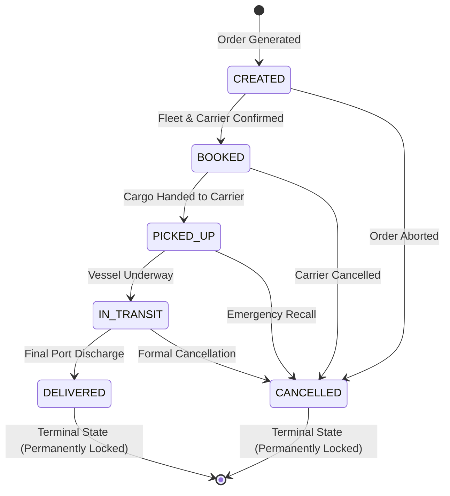
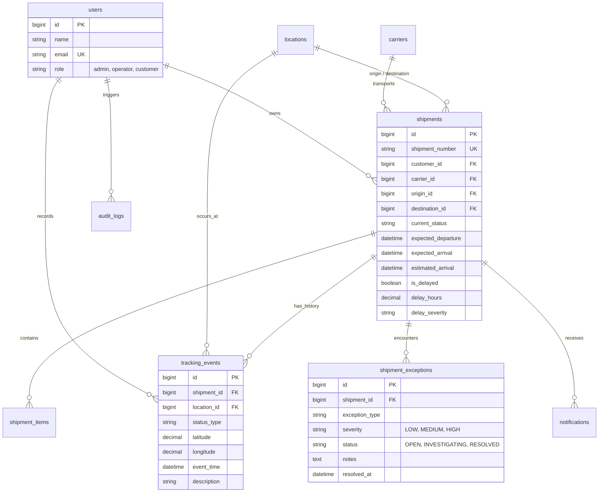

# 🚢 CargoTrace — Global Shipment Visibility & Tracking Platform

An enterprise logistics visibility platform delivering deterministic delay calculations, append-only historical tracking milestones, interactive GIS maritime waypoints, and automated exception escalation workflows.

---

## 📑 Table of Contents
1. [Project Overview & Problem Domain](#-project-overview--problem-domain)
2. [User Roles & Authorization Matrix](#-user-roles--authorization-matrix)
3. [Core Engineering Modules](#-core-engineering-modules)
   - [Shipment Lifecycle State Machine](#1-shipment-lifecycle-state-machine)
   - [Deterministic Delay Engine](#2-deterministic-delay-engine)
   - [Append-Only Historical Tracking](#3-append-only-historical-tracking)
   - [Exception Management Lifecycle](#4-exception-management-lifecycle)
   - [GIS Map & Weather Integration](#5-gis-map--weather-integration)
   - [Operational Analytics & Audit Trail](#6-operational-analytics--audit-trail)
4. [System Architecture: Service Layer](#-system-architecture-service-layer)
5. [Data Model & Schema (ERD)](#-data-model--schema-erd)
6. [RESTful API Endpoints](#-restful-api-endpoints)
7. [Automated Verification Tests](#-automated-verification-tests)
8. [Quickstart & Demo Credentials](#-quickstart--demo-credentials)
9. [Code Ownership & Defense Guide](#-code-ownership--defense-guide)

---

## 🌐 Project Overview & Problem Domain

In global ocean and multimodal logistics, shipment data is traditionally siloed across independent carriers, port authorities, and freight forwarders. Customers lack visibility while cargo is in transit, delays are discovered only after delivery deadlines have passed, and operational exceptions are handled reactively.

```
┌─────────────────────────────────┐        ┌──────────────────────────────────┐
│        EXISTING PROBLEMS        │   ──►  │        CARGOTRACE SOLUTION       │
├─────────────────────────────────┤        ├──────────────────────────────────┤
│ • Information scattered         │        │ • Centralized logistics hub      │
│ • Blind customers in transit    │        │ • Live GIS map & waypoint trails │
│ • Latent, unflagged delays      │        │ • Deterministic Delay Engine     │
│ • Ad-hoc incident handling      │        │ • 3-stage Exception Lifecycle    │
└─────────────────────────────────┘        └──────────────────────────────────┘
```

**CargoTrace solves this by providing:**
- Full end-to-end operational visibility with GPS-coordinate timeline tracking.
- Automatic delay detection based on contractual expected arrival versus estimated arrival.
- Structured escalation handling for customs holds, weather delays, and port bottlenecks.
- Role-based security ensuring customers only see their own cargo while logistics operators manage fleet operations.

---

## 👥 User Roles & Authorization Matrix

A Role-Based Access Control (RBAC) matrix enforces operational boundaries and tenant isolation:



| Capabilities / Scope | Administrator | Logistics Operator | Customer |
| :--- | :---: | :---: | :---: |
| View Operational Dashboard | ✅ Full Fleet | ✅ Full Fleet | ✅ Scoped (Own Shipments Only) |
| Search & List Shipments | ✅ All Shipments | ✅ All Shipments | ✅ Scoped (Tenant Isolated) |
| Create New Shipment Order | ✅ | ✅ | ✅ (Own Tenant Account) |
| Transition Lifecycle Status | ✅ | ✅ | ❌ Forbidden (403) |
| Soft-Delete Shipment | ✅ | ❌ Forbidden (403) | ❌ Forbidden (403) |
| Record Tracking Milestones | ✅ | ✅ | ❌ Forbidden (403) |
| Report & Resolve Exceptions | ✅ | ✅ | ❌ Forbidden (View Only) |
| Manage Carrier Fleet | ✅ | ❌ Forbidden (403) | ❌ Forbidden (403) |
| Manage Ports & Hub Locations | ✅ | ❌ Forbidden (403) | ❌ Forbidden (403) |
| Inspect System Audit Trail | ✅ | ❌ Forbidden (403) | ❌ Forbidden (403) |

---

## ⚙️ Core Engineering Modules

### 1. Shipment Lifecycle State Machine
Status transitions follow an enforced sequential state machine:



- **Validation:** Illegal state jumps (e.g., `CREATED` &rarr; `DELIVERED`) are rejected with `422 Unprocessable Entity`.
- **Terminal States:** Once marked `DELIVERED` or `CANCELLED`, records become immutable.

---

### 2. Deterministic Delay Engine
Calculates shipment schedule variance dynamically:

$$\Delta t = \text{Estimated Arrival (ETA)} - \text{Expected Arrival}$$

- If $\Delta t \le 0 \implies \text{is\_delayed} = \text{false}, \text{delay\_severity} = \text{null}$
- If $\Delta t > 0 \implies \text{is\_delayed} = \text{true}$ with severity categorization:
  - **LOW:** $\Delta t \in (0, 6\text{ hours}]$
  - **MEDIUM:** $\Delta t \in (6, 24\text{ hours}]$
  - **HIGH:** $\Delta t > 24\text{ hours}$

---

### 3. Append-Only Historical Tracking
- **Immutability:** Milestone records in `tracking_events` cannot overwrite previous entries.
- **Chronological Rule:** Any new milestone must satisfy $t_{\text{new}} \ge t_{\text{latest}}$.
- **Dynamic Current Location:** The platform resolves the vessel's current position from the latest valid coordinate entry.

---

### 4. Exception Management Lifecycle
Operational disruptions progress through a formalized three-stage resolution pipeline:

$$\text{OPEN} \longrightarrow \text{INVESTIGATING} \longrightarrow \text{RESOLVED}$$

- **Incident Types:** `CUSTOMS_HOLD`, `WEATHER_DELAY`, `PORT_CONGESTION`, `DAMAGED`, `MISROUTED`, `DOCUMENTATION_ISSUE`.
- **Resolution:** Tracks root-cause investigation notes, timestamps resolution ($t_{\text{resolved}}$), and automatically dispatches customer notifications.

---

### 5. GIS Map & Weather Integration
- **Interactive Route Mapping:** Visualizes origin port, maritime transit waypoints, and destination hub via Leaflet.js and OpenStreetMap.
- **Resilient Geocoding:** Converts address queries to coordinate pairs with a 24-hour cache layer and embedded offline fallback coordinates for major world ports.
- **Real-Time Weather Telemetry:** Fetches live marine weather (temperature, wind velocity, precipitation) at active coordinate points with a 30-minute cache layer.

---

### 6. Operational Analytics & Audit Trail
- **Live Metrics Dashboard:** Aggregates real-time order counts, active in-transit vessels, on-time delivery ratios, and open incidents.
- **Visual Analytics:** Interactive status breakdown charts, carrier volume distributions, and 14-day SLA delivery cadence trends.
- **Forensic Audit Logging:** Records every critical mutation (actor, action, auditable model, IP address, previous state JSON, and new state JSON).

---

## 🏛️ System Architecture: Service Layer

Business logic is organized into dedicated Services to ensure modularity and comprehensive testability:

```
┌─────────────────────────────────┐
│     HTTP Routing & Gateways     │ (Sanctum Auth & Role Middleware)
└────────────────┬────────────────┘
                 ▼
┌─────────────────────────────────┐
│        API Controllers          │ (Request Validation & HTTP Status Serialization)
└────────────────┬────────────────┘
                 ▼
┌─────────────────────────────────┐
│         Service Layer           │
├─────────────────────────────────┤
│ • ShipmentService               │ (Lifecycle transitions, tracking numbers)
│ • TrackingService               │ (Chronological events & coordinate tracking)
│ • EtaService                    │ (Delay delta calculations & severity matrix)
│ • ExceptionService              │ (Incident management pipeline)
│ • GeocodingService              │ (Resilient geocoding & fallbacks)
│ • WeatherService                │ (Live marine meteorological telemetry)
│ • DashboardService              │ (Aggregated analytical metrics & chart data)
│ • AuditService                  │ (Forensic change tracking)
└────────────────┬────────────────┘
                 ▼
┌─────────────────────────────────┐
│      Database & Persistence     │ (Relational models & scopes)
└─────────────────────────────────┘
```

---

## 🗄️ Data Model & Schema (ERD)



---

## 🔌 RESTful API Endpoints

All responses follow a consistent envelope contract: `{ "success": boolean, "data": ..., "message": string }`.

| Method | Endpoint | Description | Access Scope |
| :--- | :--- | :--- | :--- |
| `POST` | `/api/register` | Customer account registration | Public |
| `POST` | `/api/login` | Obtain Bearer authentication token | Public |
| `POST` | `/api/logout` | Revoke active token | Authenticated |
| `GET` | `/api/user` | Current authenticated profile | Authenticated |
| `GET` | `/api/dashboard` | Aggregated KPI operational summary | Authenticated (Scoped) |
| `GET` | `/api/dashboard/shipments-by-status` | Status distribution for chart | Authenticated |
| `GET` | `/api/dashboard/shipments-by-carrier`| Carrier volume share for chart | Authenticated |
| `GET` | `/api/dashboard/delay-trend` | 14-day SLA cadence data for chart | Authenticated |
| `GET` | `/api/shipments` | List shipments (search, filter, pagination) | Authenticated (Scoped) |
| `POST` | `/api/shipments` | Create new shipment order | Admin, Operator, Customer |
| `GET` | `/api/shipments/{id}` | Detailed shipment record & waypoints | Scoped Tenant / Ops |
| `PATCH` | `/api/shipments/{id}/status` | Execute lifecycle status transition | Admin, Operator |
| `DELETE` | `/api/shipments/{id}` | Soft-delete shipment record | Admin |
| `GET` | `/api/shipments/{id}/map` | GeoJSON coordinates for route visualization | Scoped Tenant / Ops |
| `GET` | `/api/shipments/{id}/tracking`| Chronological timeline milestones | Scoped Tenant / Ops |
| `POST` | `/api/shipments/{id}/tracking`| Append new tracking milestone | Admin, Operator |
| `GET` | `/api/exceptions` | Active operational incidents | Admin, Operator |
| `POST` | `/api/shipments/{id}/exceptions` | Flag new operational incident | Admin, Operator |
| `PATCH` | `/api/exceptions/{id}` | Update investigation or resolve incident | Admin, Operator |
| `GET/POST`| `/api/carriers` | Manage carrier fleet records | Admin (Read: All) |
| `GET/POST`| `/api/locations` | Manage hub & port master records | Admin (Read: All) |
| `GET` | `/api/geocode` | Resilient geocoding lookup | Authenticated |
| `GET` | `/api/weather` | Live marine weather telemetry | Authenticated |
| `GET` | `/api/audit-logs` | Forensic change log viewer | Admin |

> A Postman Collection v2.1 is available at [`cargotrace_postman_collection.json`](file:///d:/Antigravity/UAS%20WEB/cargotrace/cargotrace_postman_collection.json).

---

## 🧪 Automated Verification Tests

The platform is covered by an automated test suite verifying security, data isolation, lifecycle rules, and mathematical calculations:

```
PASS  Tests\Feature\AuthTest
✓ user can register successfully
✓ registration fails with invalid email or short password
✓ user can login with valid credentials
✓ login fails with incorrect password
✓ authenticated user can fetch profile
✓ unauthenticated request to protected route is rejected

PASS  Tests\Feature\DelayRuleTest
✓ no delay when on time
✓ low severity delay between zero and six hours
✓ medium severity delay between six and twenty four hours
✓ high severity delay greater than twenty four hours
✓ persisting delay engine updates shipment columns

PASS  Tests\Feature\ShipmentCrudTest
✓ admin and operator can create shipment
✓ customer isolation customer only sees own shipments
✓ admin can view all shipments
✓ only admin can delete shipment

PASS  Tests\Feature\StatusTransitionTest
✓ valid sequential lifecycle transitions
✓ illegal status jump from created to delivered is rejected
✓ delivered is terminal state and cannot transition
✓ cancelled is terminal state

Tests:    21 passed (71 assertions)
```

---

## 🚀 Quickstart & Demo Credentials

### Setup Commands
```bash
# 1. Initialize environment & database
php artisan migrate:fresh --seed

# 2. Run automated test suite
php artisan test

# 3. Start local development server
php artisan serve
```

Access the interface at **[http://127.0.0.1:8000/app](http://127.0.0.1:8000/app)**.

### Pre-Seeded Accounts
All accounts share the password: `password`

| Role | Email Address | Description |
| :--- | :--- | :--- |
| **Administrator** | `admin@cargotrace.com` | Full administrative visibility across all carriers, locations, and audit trails |
| **Logistics Operator** | `operator@cargotrace.com` | Operational control: milestone logging, state transitions, incident resolution |
| **Customer** | `customer@cargotrace.com` | Tenant isolated: restricted strictly to PT Global Logistik Nusantara shipments |

---

## 🎓 Code Ownership & Defense Guide

Key talking points for live interview verification:

1. **Service Layer Separation:**  
   Cross-cutting concerns (state validation, delay recalculation, audit logging, customer notifications) reside in `app/Services/` rather than controllers, enabling isolated unit testing.
2. **Customer Tenant Isolation:**  
   `ShipmentService::getShipmentsForUser()` checks if `$user->isCustomer()`. When true, an Eloquent scope `$query->where('customer_id', $user->id)` is appended to prevent data leaks across organizations.
3. **Delay Calculation Determinism:**  
   `EtaService::calculateDelay()` takes the difference between expected and estimated arrival in hours. When positive, it classifies the incident into `LOW` ($\le 6\text{h}$), `MEDIUM` ($\le 24\text{h}$), or `HIGH` ($> 24\text{h}$).
4. **State Transition Concurrency & Terminal States:**  
   `ShipmentService::transitionStatus()` uses atomic database transactions to guarantee integrity, and rejects changes to shipments in `DELIVERED` or `CANCELLED` states.
