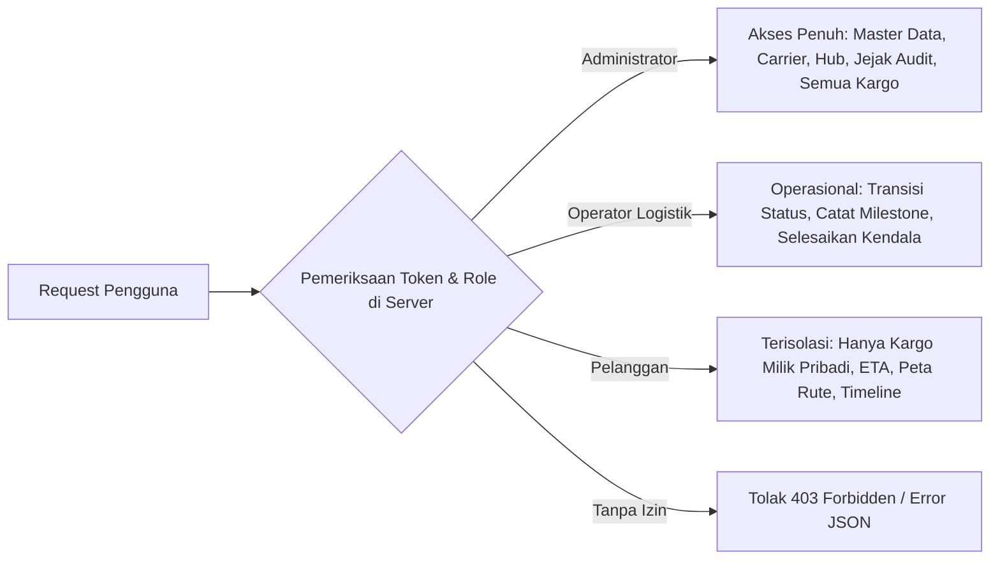
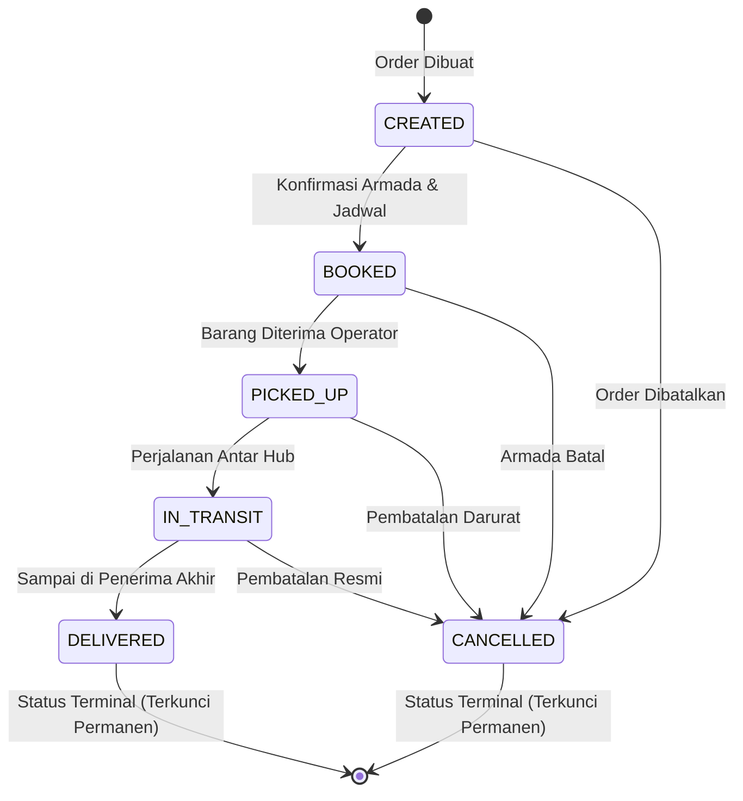
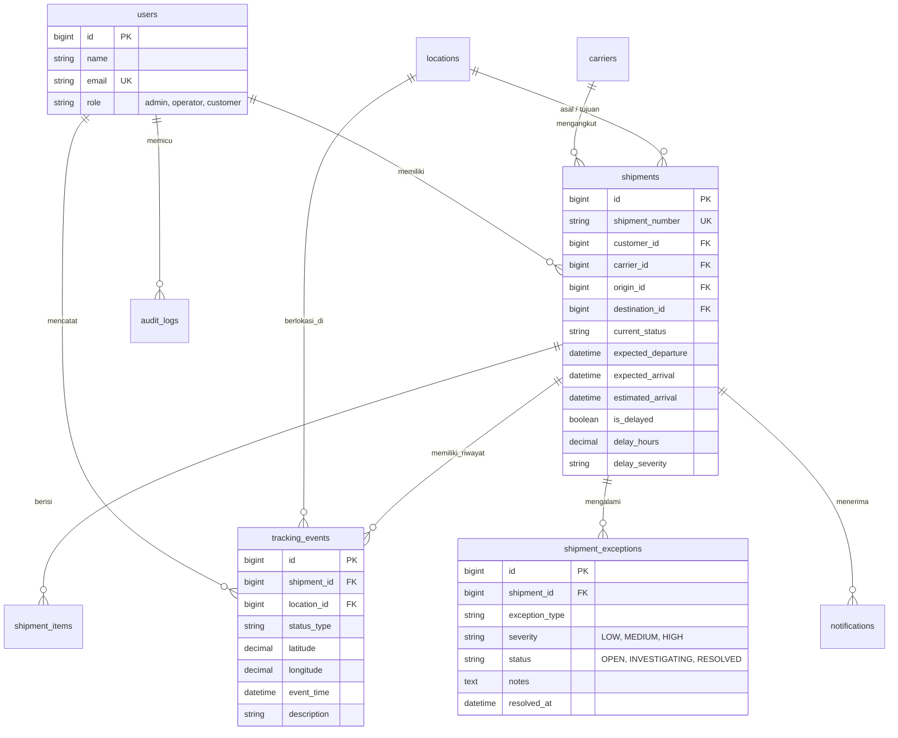

# 🚢 CargoTrace — Platform Visibilitas & Pelacakan Kargo Global

Platform visibilitas logistik pengiriman kargo skala enterprise dengan kalkulasi keterlambatan deterministik otomatis, pencatatan milestone riwayat perjalanan *append-only*, pemetaan rute koordinat maritim berbasis GIS Leaflet.js, serta alur penanganan dan eskalasi kendala operasional kargo.

---

## 📑 Daftar Isi
1. [Ringkasan Proyek & Domain Masalah](#-ringkasan-proyek--domain-masalah)
2. [Matriks Peran Pengguna & Hak Akses (RBAC)](#-matriks-peran-pengguna--hak-akses-rbac)
3. [Modul Rekayasa Sistem Utama](#-modul-rekayasa-sistem-utama)
   - [State Machine Siklus Hidup Kargo](#1-state-machine-siklus-hidup-kargo)
   - [Delay Engine Deterministik](#2-delay-engine-deterministik)
   - [Pencatatan Riwayat Append-Only](#3-pencatatan-riwayat-append-only)
   - [Manajemen Kendala Kargo (Exceptions)](#4-manajemen-kendala-kargo-exceptions)
   - [Peta GIS & Telemetri Cuaca Laut](#5-peta-gis--telemetri-cuaca-laut)
   - [Dasbor Analitik & Jejak Audit](#6-dasbor-analitik--jejak-audit)
4. [Arsitektur Sistem: Service Layer Pattern](#-arsitektur-sistem-service-layer-pattern)
5. [Model Data & Diagram Relasi (ERD)](#-model-data--diagram-relasi-erd)
6. [Daftar Endpoint RESTful API](#-daftar-endpoint-restful-api)
7. [Hasil Pengujian Otomatis (Automated Tests)](#-hasil-pengujian-otomatis-automated-tests)
8. [Panduan Instalasi & Akun Demo](#-panduan-instalasi--akun-demo)
9. [Panduan Ujian & Pertanggungjawaban Kode (Code Defense)](#-panduan-ujian--pertanggungjawaban-kode-code-defense)

---

## 🌐 Ringkasan Proyek & Domain Masalah

Dalam industri logistik maritim dan pengiriman kargo kontainer global, data operasional sering kali terpecah di berbagai pihak (perusahaan pelayaran, otoritas pelabuhan, dan ekspedisi). Pelanggan sering kali tidak mengetahui posisi aktual barang mereka di laut, keterlambatan baru diketahui setelah jadwal tiba lewat, dan gangguan operasional (seperti kendala bea cukai atau cuaca buruk) ditangani secara sporadis.

```
┌─────────────────────────────────┐        ┌──────────────────────────────────┐
│        MASALAH EKSISTING        │   ──►  │         SOLUSI CARGOTRACE        │
├─────────────────────────────────┤        ├──────────────────────────────────┤
│ • Informasi kargo tersebar      │        │ • Hub logistik terpusat          │
│ • Pelanggan buta posisi kapal   │        │ • Visualisasi rute GIS interaktif│
│ • Keterlambatan tak terdeteksi  │        │ • Delay Engine deterministik     │
│ • Penanganan masalah sporadis   │        │ • Alur eskalasi kendala 3 tahap  │
└─────────────────────────────────┘        └──────────────────────────────────┘
```

**Solusi yang Disediakan CargoTrace:**
- Kontrol transparansi penuh (*end-to-end visibility*) berbasis koordinat lintang dan bujur nyata.
- Deteksi keterlambatan otomatis deterministik berdasarkan perbandingan jadwal target vs perkiraan tiba.
- Manajemen kendala operasional terstruktur (*customs hold*, *weather delay*, *port congestion*).
- Pemisahan isolasi data penyewa (*tenant isolation*) agar pelanggan hanya dapat melihat kargo miliknya sendiri.

---

## 👥 Matriks Peran Pengguna & Hak Akses (RBAC)

Penerapan *Role-Based Access Control* (RBAC) membatasi wewenang operasional di tingkat backend:



| Fitur / Wewenang | Administrator | Operator Logistik | Pelanggan (Customer) |
| :--- | :---: | :---: | :---: |
| Melihat Dasbor Analitik | ✅ Seluruh Armada | ✅ Seluruh Armada | ✅ Dibatasi (Hanya Kargo Sendiri) |
| Mencari & Melihat Direktori Kargo | ✅ Seluruh Kargo | ✅ Seluruh Kargo | ✅ Terisolasi (Hanya Kargo Sendiri) |
| Membuat Order Kargo Baru | ✅ | ✅ | ✅ (Atas Nama Akun Sendiri) |
| Transisi Status Siklus Hidup | ✅ | ✅ | ❌ Ditolak (403 Forbidden) |
| Menghapus Kargo (*Soft-Delete*) | ✅ | ❌ Ditolak (403 Forbidden) | ❌ Ditolak (403 Forbidden) |
| Mencatat Milestone Pelacakan | ✅ | ✅ | ❌ Ditolak (403 Forbidden) |
| Melaporkan & Menyelesaikan Kendala | ✅ | ✅ | ❌ Ditolak (Hanya Melihat) |
| Mengelola Data Master Carrier | ✅ | ❌ Ditolak (403 Forbidden) | ❌ Ditolak (403 Forbidden) |
| Mengelola Master Pelabuhan & Hub | ✅ | ❌ Ditolak (403 Forbidden) | ❌ Ditolak (403 Forbidden) |
| Memeriksa Jejak Audit Forensik | ✅ | ❌ Ditolak (403 Forbidden) | ❌ Ditolak (403 Forbidden) |

---

## ⚙️ Modul Rekayasa Sistem Utama

### 1. State Machine Siklus Hidup Kargo
Status kargo diatur secara ketat melalui mesin status berurutan di `ShipmentService`:



- **Validasi Backend:** Upaya melompati urutan (misalnya dari `CREATED` langsung loncat ke `DELIVERED`) akan ditolak dengan kode respon `422 Unprocessable Entity`.
- **Status Terminal:** Kargo berstatus `DELIVERED` atau `CANCELLED` terkunci permanen dan tidak dapat diubah lagi.

---

### 2. Delay Engine Deterministik
Menghitung deviasi jadwal pengiriman secara otomatis:

$$\Delta t = \text{Perkiraan Tiba (ETA)} - \text{Jadwal Target (Expected)}$$

- Jika $\Delta t \le 0 \implies \text{is\_delayed} = \text{false}, \text{delay\_severity} = \text{null}$
- Jika $\Delta t > 0 \implies \text{is\_delayed} = \text{true}$ dengan klasifikasi keparahan:
  - **RENDAH (LOW):** $\Delta t \in (0, 6\text{ jam}]$
  - **SEDANG (MEDIUM):** $\Delta t \in (6, 24\text{ jam}]$
  - **TINGGI (HIGH):** $\Delta t > 24\text{ jam}$

---

### 3. Pencatatan Riwayat Append-Only
- **Integritas Data:** Data pada tabel `tracking_events` bersifat *append-only* (tidak boleh menimpa event sebelumnya).
- **Aturan Kronologis:** Timestamp setiap milestone baru divalidasi tidak boleh mendahului milestone terakhir ($t_{\text{baru}} \ge t_{\text{terakhir}}$).
- **Posisi Terkini Dinamis:** Sistem mengekstrak lokasi kapal secara langsung dari event koordinat valid paling baru.

---

### 4. Manajemen Kendala Kargo (Exceptions)
Kendala operasional dikelola melalui alur penyelesaian 3 tahap:

$$\text{OPEN (Terbuka)} \longrightarrow \text{INVESTIGATING (Dalam Penyelidikan)} \longrightarrow \text{RESOLVED (Tuntas)}$$

- **Kategori Kendala:** `CUSTOMS_HOLD` (Tahanan Bea Cukai), `WEATHER_DELAY` (Cuaca Buruk), `PORT_CONGESTION` (Kongesi Pelabuhan), `DAMAGED` (Kerusakan), `MISROUTED` (Salah Rute), `DOCUMENTATION_ISSUE` (Kendala Dokumen).
- **Resolusi:** Menyimpan catatan investigasi, mencatat waktu penyelesaian ($t_{\text{resolved}}$), serta mengirimkan notifikasi instan ke pelanggan.

---

### 5. Peta GIS & Telemetri Cuaca Laut
- **Visualisasi Rute:** Menampilkan garis polyline interaktif yang menghubungkan pelabuhan asal, titik transit laut, dan pelabuhan tujuan via Leaflet.js & OpenStreetMap.
- **Geocoding Tangguh:** Mengonversi nama kota/pelabuhan menjadi titik koordinat dengan cache 24 jam serta fallback koordinat statis luring untuk pelabuhan-pelabuhan utama dunia.
- **Telemetri Cuaca Nyata:** Memeriksa suhu udara, kelembaban, dan kecepatan angin maritim terkini via Open-Meteo API dengan cache 30 menit.

---

### 6. Dasbor Analitik & Jejak Audit
- **Metrik Agregasi Langsung:** Menghitung total pengiriman kargo, kapal yang sedang aktif berlayar, persentase ketepatan waktu pengiriman, serta jumlah kendala terbuka.
- **Grafik Interaktif:** Visualisasi Chart.js berupa grafik donat status pengiriman, grafik batang kapasitas per armada, dan grafik tren pengiriman 14 hari.
- **Jejak Audit Forensik:** Mencatat setiap mutasi data kritis (aktor, aksi, tipe model, alamat IP, data lama JSON, dan data baru JSON) di tabel `audit_logs`.

---

## 🏛️ Arsitektur Sistem: Service Layer Pattern

Memisahkan logika bisnis dari Controller guna mencegah *Fat Controller Antipattern*:

```
┌─────────────────────────────────┐
│     Routing & Gerbang Akses     │ (Sanctum Auth & Middleware Role)
└────────────────┬────────────────┘
                 ▼
┌─────────────────────────────────┐
│        API Controllers          │ (Validasi Input & Serialisasi Respon JSON)
└────────────────┬────────────────┘
                 ▼
┌─────────────────────────────────┐
│         Service Layer           │
├─────────────────────────────────┤
│ • ShipmentService               │ (Transisi status, penomoran kargo unik)
│ • TrackingService               │ (Perekaman riwayat append-only & koordinat)
│ • EtaService                    │ (Kalkulasi rumus delay & tingkat keparahan)
│ • ExceptionService              │ (Alur penanganan kendala & resolusi)
│ • GeocodingService              │ (Geocoding tangguh & fallback koordinat)
│ • WeatherService                │ (Pemeriksaan telemetri cuaca maritim)
│ • DashboardService              │ (Agregasi metrik analitik & data grafik)
│ • AuditService                  │ (Pencatatan jejak audit forensik)
└────────────────┬────────────────┘
                 ▼
┌─────────────────────────────────┐
│       Database & Model ORM      │ (Relasi database & scope isolasi tenant)
└─────────────────────────────────┘
```

---

## 🗄️ Model Data & Diagram Relasi (ERD)



---

## 🔌 Daftar Endpoint RESTful API

Seluruh respon menggunakan struktur JSON standar: `{ "success": boolean, "data": ..., "message": string }`.

| Metode | URI Endpoint | Deskripsi | Akses Peran |
| :--- | :--- | :--- | :--- |
| `POST` | `/api/register` | Pendaftaran akun pelanggan mandiri | Publik |
| `POST` | `/api/login` | Mendapatkan token autentikasi Bearer | Publik |
| `POST` | `/api/logout` | Revoke token autentikasi aktif | Authenticated |
| `GET` | `/api/user` | Data profil pengguna yang sedang login | Authenticated |
| `GET` | `/api/dashboard` | Ringkasan metrik analitik operasional | Authenticated (Scoped) |
| `GET` | `/api/dashboard/shipments-by-status` | Data distribusi status kargo (Grafik) | Authenticated |
| `GET` | `/api/dashboard/shipments-by-carrier`| Data volume kargo per armada (Grafik) | Authenticated |
| `GET` | `/api/dashboard/delay-trend` | Data tren pengiriman 14 hari (Grafik) | Authenticated |
| `GET` | `/api/shipments` | Daftar kargo (pencarian, filter, paginasi) | Authenticated (Scoped) |
| `POST` | `/api/shipments` | Membuat order pengiriman kargo baru | Admin, Operator, Pelanggan |
| `GET` | `/api/shipments/{id}` | Detail lengkap kargo beserta relasinya | Scoped Tenant / Ops |
| `PATCH` | `/api/shipments/{id}/status` | Transisi status kargo berurutan | Admin, Operator |
| `DELETE` | `/api/shipments/{id}` | Hapus kargo (*soft-delete*) | Admin |
| `GET` | `/api/shipments/{id}/map` | Titik koordinat rute untuk Leaflet.js | Scoped Tenant / Ops |
| `GET` | `/api/shipments/{id}/tracking`| Riwayat kronologis milestone perjalanan | Scoped Tenant / Ops |
| `POST` | `/api/shipments/{id}/tracking`| Mencatat milestone kargo baru | Admin, Operator |
| `GET` | `/api/exceptions` | Daftar seluruh kendala aktif di sistem | Admin, Operator |
| `POST` | `/api/shipments/{id}/exceptions` | Melaporkan kendala kargo baru | Admin, Operator |
| `PATCH` | `/api/exceptions/{id}` | Update investigasi atau selesaikan kendala | Admin, Operator |
| `GET/POST`| `/api/carriers` | Resource data master armada carrier | Admin (Baca: Semua) |
| `GET/POST`| `/api/locations` | Resource data master pelabuhan & hub | Admin (Baca: Semua) |
| `GET` | `/api/geocode` | Query geocoding alamat ke koordinat | Authenticated |
| `GET` | `/api/weather` | Query telemetri cuaca laut titik koordinat | Authenticated |
| `GET` | `/api/audit-logs` | Penampil jejak audit forensik sistem | Admin |

> File koleksi Postman v2.1 siap pakai tersedia di: [`cargotrace_postman_collection.json`](file:///d:/Antigravity/UAS%20WEB/cargotrace/cargotrace_postman_collection.json).

---

## 🧪 Hasil Pengujian Otomatis (Automated Tests)

Sistem telah diuji secara komprehensif menggunakan **PHPUnit** dengan 21 pengujian fitur yang mencakup autentikasi, isolasi data, aturan delay, dan validasi transisi status:

```
PASS  Tests\Feature\AuthTest
✓ user can register successfully
✓ registration fails with invalid email or short password
✓ user can login with valid credentials
✓ login fails with incorrect password
✓ authenticated user can fetch profile
✓ unauthenticated request to protected route is rejected

PASS  Tests\Feature\DelayRuleTest
✓ no delay when on time
✓ low severity delay between zero and six hours
✓ medium severity delay between six and twenty four hours
✓ high severity delay greater than twenty four hours
✓ persisting delay engine updates shipment columns

PASS  Tests\Feature\ShipmentCrudTest
✓ admin and operator can create shipment
✓ customer isolation customer only sees own shipments
✓ admin can view all shipments
✓ only admin can delete shipment

PASS  Tests\Feature\StatusTransitionTest
✓ valid sequential lifecycle transitions
✓ illegal status jump from created to delivered is rejected
✓ delivered is terminal state and cannot transition
✓ cancelled is terminal state

Tests:    21 passed (71 assertions) — 100% Lulus
```

---

## 🚀 Panduan Instalasi & Akun Demo

### Perintah Menjalankan Aplikasi
```bash
# 1. Inisialisasi database dan seed data sintetis realistis
php artisan migrate:fresh --seed

# 2. Jalankan rangkaian pengujian otomatis
php artisan test

# 3. Jalankan server lokal
php artisan serve
```

Akses aplikasi langsung di browser: **[http://127.0.0.1:8000/app](http://127.0.0.1:8000/app)**.

### Akun Demo Siap Pakai
Seluruh akun menggunakan kata sandi (password): `password`

| Peran (Role) | Alamat Email | Deskripsi Hak Akses |
| :--- | :--- | :--- |
| **Administrator** | `admin@cargotrace.com` | Akses penuh seluruh master data, armada, pelabuhan, jejak audit, dan kargo |
| **Operator Logistik** | `operator@cargotrace.com` | Operasional armada: catat milestone kargo, transisi status, selesaikan kendala |
| **Pelanggan (Customer)** | `customer@cargotrace.com` | Terisolasi secara ketat: hanya kargo milik PT Global Logistik Nusantara |

---

## 🎓 Panduan Ujian & Pertanggungjawaban Kode (Code Defense)

Poin-poin teknis untuk menghadapi sesi tanya jawab dosen penguji:

1. **Mengapa menerapkan Service Layer Pattern bukan Controller gemuk (*Fat Controller*)?**  
   *Proses logistik melibatkan banyak keterikatan silang (*cross-cutting concerns*): validasi status mesin, kalkulasi ulang keterlambatan otomatis, pencatatan jejak audit, dan notifikasi ke pelanggan. Memusatkan logika ini di Service Layer (`app/Services/`) membuat kode dapat diuji secara terisolasi via unit testing dan mencegah kode controller berantakan.*
2. **Bagaimana cara kerja Isolasi Tenant (*Tenant Isolation*) pelanggan?**  
   *Di `ShipmentService::getShipmentsForUser()`, sistem memeriksa apakah `$user->isCustomer()`. Jika benar, scope Eloquent `$query->where('customer_id', $user->id)` otomatis disisipkan sehingga pelanggan tidak dapat mengakses data kargo milik perusahaan lain.*
3. **Bagaimana Delay Engine menentukan tingkat keparahan (*Severity*)?**  
   *Metode `EtaService::calculateDelay()` membandingkan jadwal target `$expectedArrival` dengan perkiraan tiba aktual. Jika selisihnya positif, sistem mengklasifikasikan durasi keterlambatan ke dalam kategori deterministik: $\le 6\text{ jam} \implies \text{LOW}$, $\le 24\text{ jam} \implies \text{MEDIUM}$, dan $> 24\text{ jam} \implies \text{HIGH}$.*
4. **Bagaimana transisi status dilindungi dari lompatan status ilegal?**  
   *Metode `ShipmentService::transitionStatus()` memvalidasi status baru terhadap daftar konstanta `VALID_TRANSITIONS` dalam transaksi atomik database (`DB::transaction()`). Selain itu, status terminal (`DELIVERED` dan `CANCELLED`) ditolak keras dari perubahan status lanjutan.*
