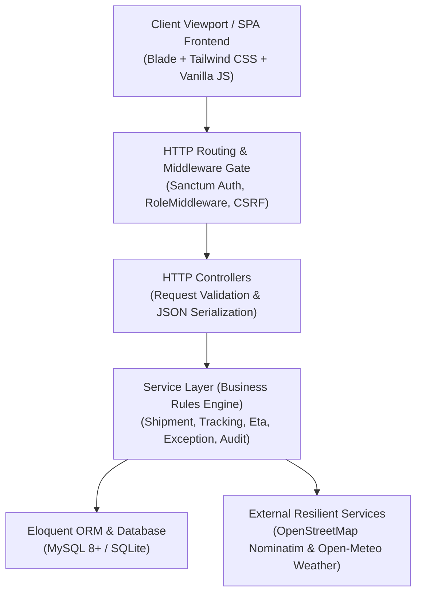
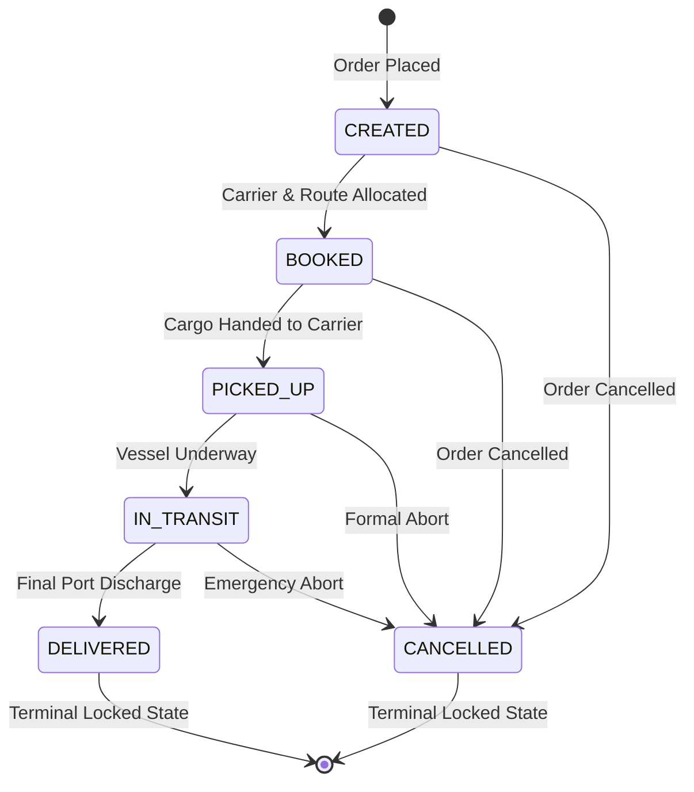
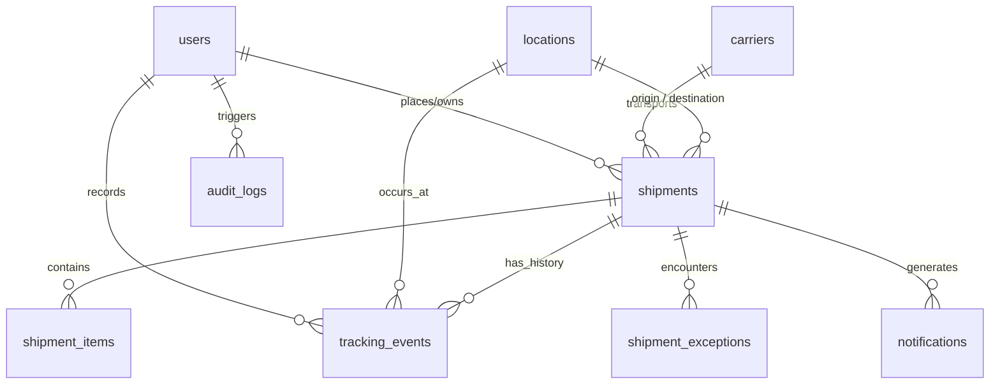

# 🚢 CargoTrace — Global Shipment Visibility & Tracking Platform

[](https://laravel.com)
[](https://php.net)
[](#-automated-testing-suite)
[](#)

> **UAS Web Programming 2 — Portfolio-Grade Capstone Project**  
> An enterprise-grade logistics visibility engine delivering deterministic delay calculations, append-only historical tracking milestones, interactive Leaflet.js GIS waypoints, and automated exception escalation lifecycles.

---

## 📑 Table of Contents
1. [Executive Summary & Architecture](#-executive-summary--architecture)
2. [Domain Problem & Proposed Solution](#-domain-problem--proposed-solution)
3. [User Roles & Authorization Matrix (RBAC)](#-user-roles--authorization-matrix-rbac)
4. [Core Business Logic & Engineering Engines](#-core-business-logic--engineering-engines)
   - [Shipment Lifecycle State Machine](#1-shipment-lifecycle-state-machine)
   - [Deterministic Delay Engine](#2-deterministic-delay-engine)
   - [Append-Only Historical Tracking](#3-append-only-historical-tracking)
   - [Exception Management Lifecycle](#4-exception-management-lifecycle)
   - [Resilient External API Integrations](#5-resilient-external-api-integrations)
5. [Database Schema & Entity Relationship](#-database-schema--entity-relationship)
6. [RESTful API Specification & Contracts](#-restful-api-specification--contracts)
7. [Automated Testing Suite (PHPUnit)](#-automated-testing-suite)
8. [Local Installation & Setup Guide](#-local-installation--setup-guide)
9. [Pre-Seeded Demo Accounts](#-pre-seeded-demo-accounts)
10. [Code Ownership Defense Guide](#-code-ownership-defense-guide)

---

## 🎯 Executive Summary & Architecture

CargoTrace rejects the "Fat Controller" antipattern and implements a clean **Service Layer Pattern**:



### Architecture Components:
* **`ShipmentService`**: Enforces strict lifecycle state machines, auto-generates format `CT-YYYYMMDD-XXXXX` tracking identifiers, and handles customer tenant isolation.
* **`TrackingService`**: Append-only milestone recording with chronological integrity checks and coordinate-based waypoint synthesis.
* **`EtaService`**: Mathematical delay calculations ($\Delta t = \text{ETA} - \text{Expected}$) mapping to LOW, MEDIUM, and HIGH severity categories.
* **`ExceptionService`**: Manages incident escalation pipelines (`OPEN` &rarr; `INVESTIGATING` &rarr; `RESOLVED`).
* **`GeocodingService` & `WeatherService`**: Fault-tolerant external HTTP clients with fallback mechanisms and 24-hour cache persistence.
* **`AuditService`**: Forensic immutable audit logs recording actor, action, previous state, and new state.

---

## 🌐 Domain Problem & Proposed Solution

```
┌─────────────────────────────────┐        ┌──────────────────────────────────┐
│       EXISTING PROBLEMS         │   ──►  │       CARGOTRACE SOLUTION        │
├─────────────────────────────────┤        ├──────────────────────────────────┤
│ • Fragmented logistics data     │        │ • Centralized Hub (Carrier/Port) │
│ • Blind customers during transit│        │ • Live GIS Timeline & Route Map  │
│ • Hidden, unforecasted delays   │        │ • Deterministic Delay Engine     │
│ • Ad-hoc incident handling      │        │ • Exception Lifecycle Workflows  │
└─────────────────────────────────┘        └──────────────────────────────────┘
```

---

## 👥 User Roles & Authorization Matrix (RBAC)

| Feature / Action | Admin | Logistics Operator | Customer |
| :--- | :---: | :---: | :---: |
| View Analytics Dashboard | ✅ Full | ✅ Full | ✅ Scoped (Own Shipments) |
| List & Search Shipments | ✅ All Shipments | ✅ All Shipments | ✅ Tenant Isolated (Only Own) |
| Create New Shipment | ✅ | ✅ | ✅ (Own Tenant) |
| Transition Status State | ✅ | ✅ | ❌ Forbidden (403) |
| Soft-Delete Shipment | ✅ | ❌ Forbidden (403) | ❌ Forbidden (403) |
| Record Tracking Milestones | ✅ | ✅ | ❌ Forbidden (403) |
| Report & Resolve Exceptions | ✅ | ✅ | ❌ Forbidden (Read Only) |
| Manage Carriers & Locations | ✅ | ❌ Forbidden (403) | ❌ Forbidden (403) |
| View System Audit Trail | ✅ | ❌ Forbidden (403) | ❌ Forbidden (403) |

---

## ⚙️ Core Business Logic & Engineering Engines

### 1. Shipment Lifecycle State Machine
Status transitions are strictly governed in `ShipmentService`:



* Any attempt to skip sequence steps (e.g., `CREATED` &rarr; `DELIVERED`) throws `422 Unprocessable Entity`.
* `DELIVERED` and `CANCELLED` represent **Terminal States** that are permanently locked against modifications.

---

### 2. Deterministic Delay Engine
Calculated automatically inside `EtaService`:

$$\Delta t = \text{Estimated Arrival (ETA)} - \text{Expected Arrival}$$

- If $\Delta t \le 0 \implies \text{is\_delayed} = \text{false}, \text{severity} = \text{null}$
- If $\Delta t > 0 \implies \text{is\_delayed} = \text{true}$ with severity breakdown:
  - **LOW:** $\Delta t \in (0, 6\text{ hours}]$
  - **MEDIUM:** $\Delta t \in (6, 24\text{ hours}]$
  - **HIGH:** $\Delta t > 24\text{ hours}$

---

### 3. Append-Only Historical Tracking
Records in `tracking_events` are append-only. When a new waypoint is submitted:
1. Chronological integrity is strictly enforced ($t_{\text{new}} \ge t_{\text{latest}}$).
2. If `status_type` matches a lifecycle step, `ShipmentService` automatically synchronizes `current_status`.
3. Coordinates are linked dynamically to provide route waypoints for the Leaflet.js interactive map.

---

### 4. Exception Management Lifecycle
Incidents follow an auditable three-step operational workflow:

$$\text{OPEN} \longrightarrow \text{INVESTIGATING} \longrightarrow \text{RESOLVED}$$

- Valid Types: `CUSTOMS_HOLD`, `WEATHER_DELAY`, `PORT_CONGESTION`, `DAMAGED`, `MISROUTED`, `DOCUMENTATION_ISSUE`.
- Automatically emits a customer notification and sets `resolved_at` upon operational sign-off.

---

### 5. Resilient External API Integrations
- **Nominatim Geocoding API (`GeocodingService`)**: Translates city/port names to latitude/longitude with 24-hour cache layer and embedded offline fallback coordinates for major world ports.
- **Open-Meteo Weather API (`WeatherService`)**: Real-time maritime condition fetch with 30-minute caching and timeout retries.

---

## 🗄️ Database Schema & Entity Relationship



---

## 🔌 RESTful API Specification & Contracts

All endpoints return uniform, structured JSON: `{ "success": true, "data": ..., "message": ... }`.

| Method | Endpoint | Description | Access Role |
| :--- | :--- | :--- | :--- |
| `POST` | `/api/register` | Customer self-registration | Public |
| `POST` | `/api/login` | Acquire Bearer Token (Sanctum) | Public |
| `POST` | `/api/logout` | Invalidate current token | Authenticated |
| `GET` | `/api/user` | Current authenticated user profile | Authenticated |
| `GET` | `/api/dashboard` | KPI metrics & recent activity | Authenticated (Scoped) |
| `GET` | `/api/dashboard/shipments-by-status` | Status breakdown for Doughnut chart | Authenticated |
| `GET` | `/api/dashboard/shipments-by-carrier` | Volume by carrier for Bar chart | Authenticated |
| `GET` | `/api/dashboard/delay-trend` | 14-day delay vs on-time line chart | Authenticated |
| `GET` | `/api/shipments` | Paginated shipments directory (filter & search) | Authenticated (Scoped) |
| `POST` | `/api/shipments` | Create new shipment order | Admin, Operator, Customer |
| `GET` | `/api/shipments/{id}` | Detailed shipment record with relations | Scoped Tenant / Ops |
| `PATCH` | `/api/shipments/{id}/status` | Transition lifecycle state | Admin, Operator |
| `DELETE` | `/api/shipments/{id}` | Soft-delete shipment | Admin |
| `GET` | `/api/shipments/{id}/map` | Waypoint coordinates for Leaflet.js | Scoped Tenant / Ops |
| `GET` | `/api/shipments/{id}/tracking`| Historical timeline milestones | Scoped Tenant / Ops |
| `POST` | `/api/shipments/{id}/tracking`| Record tracking waypoint milestone | Admin, Operator |
| `GET` | `/api/exceptions` | List open incidents across system | Admin, Operator |
| `POST` | `/api/shipments/{id}/exceptions` | Report operational incident | Admin, Operator |
| `PATCH` | `/api/exceptions/{id}` | Update or resolve exception | Admin, Operator |
| `GET/POST` | `/api/carriers` | Manage carrier fleet | Admin (Read: All) |
| `GET/POST` | `/api/locations` | Manage hub/port locations | Admin (Read: All) |
| `GET` | `/api/geocode` | Resilient geocoding query | Authenticated |
| `GET` | `/api/weather` | Resilient coordinates weather query | Authenticated |
| `GET` | `/api/audit-logs` | Forensic system audit trail | Admin |

> A ready-to-import Postman Collection v2.1 is available at [`cargotrace_postman_collection.json`](file:///d:/Antigravity/UAS%20WEB/cargotrace/cargotrace_postman_collection.json).

---

## 🧪 Automated Testing Suite

CargoTrace includes a comprehensive automated test suite built with **PHPUnit**:

```bash
php artisan test
```

### Test Coverage Results (100% Green):
```
PASS  Tests\Unit\ExampleTest
✓ that true is true

PASS  Tests\Feature\AuthTest
✓ user can register successfully
✓ registration fails with invalid email or short password
✓ user can login with valid credentials
✓ login fails with incorrect password
✓ authenticated user can fetch profile
✓ unauthenticated request to protected route is rejected

PASS  Tests\Feature\DelayRuleTest
✓ no delay when on time
✓ low severity delay between zero and six hours
✓ medium severity delay between six and twenty four hours
✓ high severity delay greater than twenty four hours
✓ persisting delay engine updates shipment columns

PASS  Tests\Feature\ShipmentCrudTest
✓ admin and operator can create shipment
✓ customer isolation customer only sees own shipments
✓ admin can view all shipments
✓ only admin can delete shipment

PASS  Tests\Feature\StatusTransitionTest
✓ valid sequential lifecycle transitions
✓ illegal status jump from created to delivered is rejected
✓ delivered is terminal state and cannot transition
✓ cancelled is terminal state

Tests:    21 passed (71 assertions)
Duration: 3.02s
```

---

## 💻 Local Installation & Setup Guide

### Prerequisites
* PHP 8.2+ with `pdo_sqlite`, `pdo_mysql`, `zip` extensions enabled.
* Composer 2.x
* MySQL 8.x (Optional — SQLite is pre-configured for instant zero-config startup)

### 1. Clone & Enter Repository
```bash
git clone <repository_url> cargotrace
cd cargotrace
```

### 2. Configure Environment
```bash
cp .env.example .env
php artisan key:generate
```

### 3. Migrate & Seed Database
```bash
php artisan migrate:fresh --seed
```
*Creates all 13 migration tables and populates with realistic worldwide shipping data.*

### 4. Run Automated Tests
```bash
php artisan test
```

### 5. Start Development Server
```bash
php artisan serve
```
Open **[http://127.0.0.1:8000](http://127.0.0.1:8000)** in your browser!

---

## 🔑 Pre-Seeded Demo Accounts

All pre-seeded demo accounts share the password: `password`

| Role | Email Address | Access Scope |
| :--- | :--- | :--- |
| **Administrator** | `admin@cargotrace.com` | Full administrative access, carriers, hubs, audit logs, all shipments |
| **Logistics Operator** | `operator@cargotrace.com` | Operational control: status transitions, waypoints, exception resolutions |
| **Customer Tenant** | `customer@cargotrace.com` | Isolated self-tracking: PT Global Logistik Nusantara shipments only |

---

## 🎓 Code Ownership Defense Guide

Prepared for live coding interviews & defense questions:

1. **Why Service Layer Pattern instead of Fat Controller?**  
   *Logistics workflows involve cross-cutting concerns (state validation, automatic delay recalculations, audit logging, and customer notifications). Keeping them in Services makes them testable in isolation and prevents controller bloat.*
2. **How does Tenant Isolation work?**  
   *In `ShipmentService::getShipmentsForUser()`, queries check `$user->isCustomer()`. When true, an Eloquent scope `$query->where('customer_id', $user->id)` is automatically appended. Show `ShipmentCrudTest::test_customer_isolation_customer_only_sees_own_shipments()` as proof.*
3. **How does the Delay Engine calculate severity?**  
   *Point to `EtaService::calculateDelay()`. It compares `$expectedArrival` with `$referenceTime` ($t_{\text{est}}$), converts seconds to hours, and applies deterministic thresholds ($\le 6\text{h} \implies \text{LOW}$, $\le 24\text{h} \implies \text{MEDIUM}$, $> 24\text{h} \implies \text{HIGH}$).*
4. **How are state transitions protected from race conditions and invalid jumps?**  
   *Point to `ShipmentService::transitionStatus()` and `ShipmentService::VALID_TRANSITIONS`. Status transitions are wrapped in atomic `DB::transaction()` and reject terminal status tampering.*
